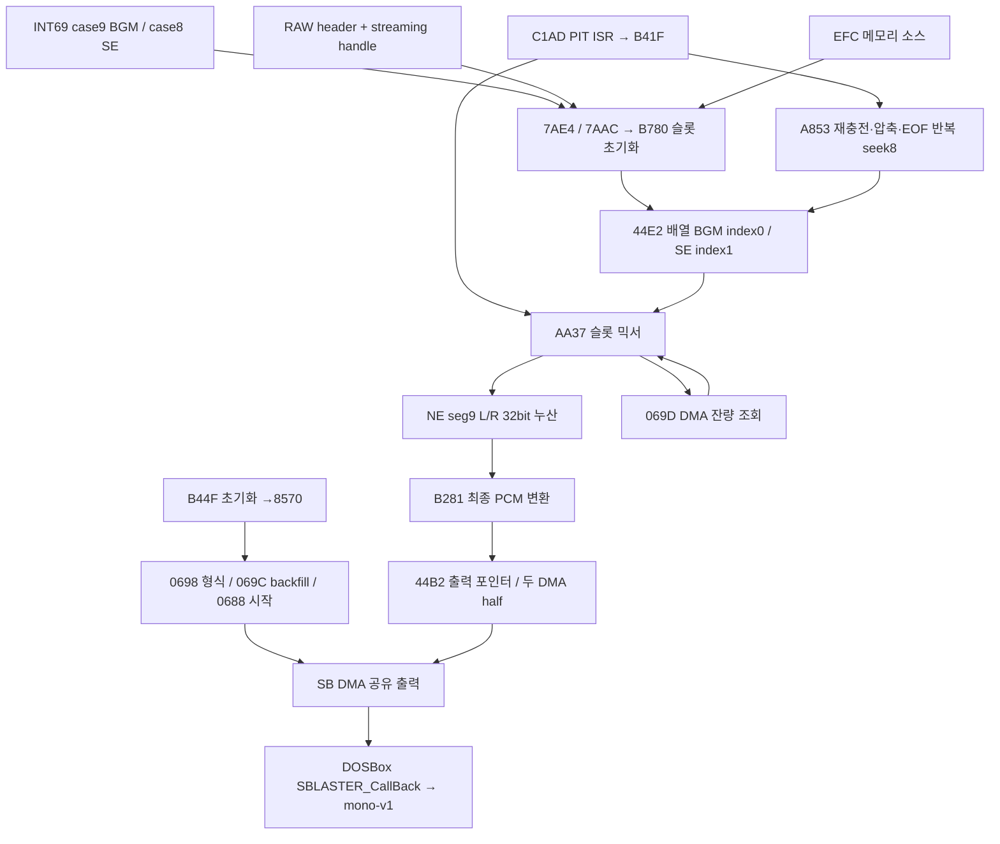

# Phase 9-8G — BGM 전용 믹싱 경계와 분리 어댑터 연구

작성: 2026-11-10. 기존9-8B~9-8F 보고서와 구현을 이어서 조사했다.

**참조 LOGO.EXE에서 BGM 슬롯과 SE 슬롯이 합산되는 정확한 코드 경계를 찾았다. 공개 합성 시험에서는 BGM 기여분만 제외하고 SE, 재생 위치, DMA 완료 IRQ를 보존했다. 실제 ED4에 연결하는 native 분리 어댑터는 아직 구현·검증하지 않았다. 제품2×는 계속 비활성이다.** 게임/엔진/배포본을 변경하지 않은 로컬 분석·공개 실험 단계다.

## 1. 증거와 주소의 범위

기존 Galaxy의 첫 필드→전투→필드 복귀, INT69 AX9/BX9→10→9와 `_ED4-09.RAW`→`_ED4-10.RAW`→`_ED4-09.RAW` 대응은 이미 확보된 사실로 사용했다. 첫 스냅샷의 타이틀 표기는 필드로 해석한다. 그 실행의 CS7227/IP2560은 고정 후킹 주소가 아니다. 원본 JSON은 로컬에 없으며 없는 데이터를 재구성하지 않았다. **같은 세 장면의 재수집을 요청하지 않는다.**

읽기 전용 조사 파일:

- `D:/ed4_rs_cb/ED4/LOGO.EXE`, 409850B, SHA-256 `fa3db4b431e157be80d7110006a4c6fc854c0e02ee396b3591b76a45702412d1`.
- `D:/ed4_rs_cb/ED4/SOUNDRV.COM`, 4704B. 조사 전후 해시 보존 검사 대상이다.

해시는 조사 자료의 식별자이며 게임 실행 허용 조건이 아니다. Galaxy 등록본과의 모든 바이트 일치를 새로 확인했다고 주장하지 않는다. 54곡/297맵 재분석이나 RAW 전체 해시 수집은 하지 않았다.

아래 `file`은 정적 파일 offset, `seg:offset`은 **NE 논리 세그먼트**다. 런타임 CS/selector와 같지 않다. NE relocation을 해석하여 far-call과 데이터 selector 참조를 확인했다. 파일에 있는 FFFF relocation 자리 표시자를 실제 잘못된 주소로 해석하지 않았다.

재현 도구: `scripts/inspect-phase9-8g-mixer.py`. 기본 실행은 `artifacts/phase9-8g/call-metadata.json`에 세그먼트·호출·슬롯 참조·합산 명령 주소만 저장한다. 선형 디스어셈블리에서 얻은1106개 call 후보 전체를 실행 가능한 그래프라고 주장하지 않는다. 아래 선택 경로는 함수 경계·분기·relocation을 개별 대조했다. B40F/B417 등의 점프 테이블은 명령 코드가 아니다. 게임 코드 전체나 샘플 바이트는 보고서/JSON에 넣지 않았다.

## 2. 슬롯 구조와 리소스 소유권

### 참조 설치본의 슬롯 배정

- INT69 case8: fileCC96 → seg2:06AC/file7AAC → **슬롯2** 인수 → B780. SE descriptor는 DS3A22 + ID×12h, 최대148개다.
- INT69 case9: fileCC9F → seg2:06E4/file7AE4 → **슬롯1** 인수 → B780. BGM descriptor DS448A, 파일 핸들449C:449E를 descriptor4496:4498에 연결한다.
- case10: fileCCAC → seg2:07CE/file7BCE. 이전 음악 핸들을 닫고 관련 참조를0으로 한 뒤 BD35로 슬롯1 활성 상태를 해제한다.
- seg6:0000/fileCA00의 초기화는 슬롯 수2, 출력 format1, rate55F0h=**22000Hz**를 B44F에 전달한다. 라이브 Galaxy의 실제 설정값은 이 정적 인수만으로 확정하지 않는다.

공개 API 슬롯1/2는 내부 배열 index0/1이다. 이 참조 설치본은 SE마다 별도 하드웨어 채널을 만드는 것이 아니라 SE용 논리 슬롯2를 재사용한다. 수정본의 슬롯 수·용도·alias 여부는 미확인이다.

### 배열 레이아웃

DS44E0=슬롯 수, 배열 DS44E2, stride3Ah(58B). 초기화는 최대32칸에 해당하는740h를 지운다. 아래 필드 주소는 **index0의 DS 상대 주소**다.

| 상대 offset | DS 주소 | 읽기/쓰기에서 확인한 의미 |
|---|---|---|
| +00 | 44E2 | 활성 word |
| +02 | 44E4 | PCM 형식 word: 0=U8 mono, 1=U8 stereo, 2=S16 mono, 3=S16 stereo |
| +04 | 44E6 | source rate dword, 헤더 word를 확장 |
| +08 | 44EA | 전체 데이터 길이 dword |
| +0C | 44EE | 소스 버퍼 기준 far pointer |
| +10/+14 | 44F2/44F6 | volume/level, pan 입력 dword |
| +18/+1C | 44FA/44FE | 실제 L/R gain dword |
| +20/+24 | 4502/4506 | 정수 byte step, 분수 step |
| +28 | 450A | 분수 phase |
| +2C | 450E | 버퍼에 남은 byte 수 |
| +30 | 4512 | 현재 소스 far pointer |
| +34 | 4516 | 스트리밍 FILE 유사 객체 far pointer; 0이면 메모리 소스 |
| +38 | 451A | 반복 word |

헤더8B는 format word/rate word/length dword다. 확장 descriptor12h는 소스 buffer pointer(+8), file handle(+C), loop(+10)를 포함한다.

SE 준비(seg2:0305/file7705)는 EFC를 열어 길이를 구하고 전체 데이터용 메모리를 확보·읽은 후 파일을 닫는다. format0, rate2004h=8196을 descriptor에 둔다. BGM 준비(seg2:05CD/file79CD→seg5:18E3/fileC0E3)는 **FFF0h=65520B 전용 스트리밍 버퍼**를 할당한다. BGM 파일 버퍼와 최종 DMA 버퍼는 같은 객체가 아니다.

ID2/54에서는 BGM loop word449A를0, 그 외에는1로 둔다. 이번에 refill 소비 경로까지 따라가 반복 의미의 정적 근거를 보강했다. 실제 음악 정지/반복/게임 일시정지의 모든 런타임 의미를 검증한 것은 아니다.

## 3. 함수 호출 및 데이터 흐름



| 논리 주소 / file | 입력→출력·사용 필드 | 확인한 호출 관계 / 한계 |
|---|---|---|
| seg5:0C4F / B44F | slot count, 출력 format/rate → 공통 출력 설정44C4/44C6, half 크기44CA, frame 수44CC | 드라이버83B1, PIT C322, callback C375, 출력 silence85F8, 시작8570. 디바이스 초기화 성공은 정적 분석만으로 확정하지 않음 |
| seg5:0F80 / B780 | slot 번호+descriptor → 위 배열 필드, active=1 | streaming 첫 read B8DB→seg1:24AB/file36AB. 소스 format/rate에 따라 byte step 산출. 슬롯0인수의 빈 슬롯 선택 경로도 있지만 BGM/SE 호출은 명시1/2 |
| seg5:0E2C / B62C | level/pan/master L/R →44FA/44FE gain | seg1:4048/file5248 곱셈 helper. 모든 수정본의 saturation 동작까지 일반화하지 않음 |
| seg5:0053 / A853 | active+handle+remaining → 압축/refill/loop/pointer 갱신 | AA07 wrapper에서 호출. InDOS 상태와44CE guard 확인 |
| seg5:0237 / AA37 | 모든 활성 슬롯 PCM → seg9 공통 누산 → 최종 PCM | 069D 조회839C→9748; 슬롯 소비 상태를 갱신. 아래 합산 위치를 직접 확인 |
| seg5:0A81 / B281 | seg9 누산값 →44B2 포인터가 가리키는 출력 half | 독립 함수라기보다 AA37 내부 출력 변환 구간. 형식별 변환 후 half selector2DDA 반전 |
| seg5:1535 / BD35 | 지정 slot →active=0 | BGM stop7BCE에서slot1. 이 지점만으로 버퍼 전체가 해제된다고 주장하지 않음 |
| seg5:0C1F / B41F | PIT callback → AA37 | 전용 SS:SP 문맥 전환을 포함. native adapter가 문맥을 무시하면 위험 |
| seg5:19AD / C1AD | PIT IRQ → 등록 callback/주기적 refill | C20C의 DS503E 간접 호출이 등록된 B41F로 연결. 기존 PIC/EOI 처리 보존 필요 |
| seg3:0570 / 8570 | 공통 출력 descriptor → DIGPAK 시작 | 95E6(0698),96FF(069C DX1),9434(0688), DPMI real INT wrapper A615와 연결 |

### 재충전 및 재생 위치

A853은 활성·handle!=0·remaining<EFF0h·InDOS 조건을 확인한다. 남은 데이터를 buffer base로 옮기고(seg1:10CA/file22CA), `FFF0h-remaining-1`만큼 읽는다(A954→36AB). short read이며 loop!=0이면 A9A7→seg1:2BFF/file3DFF로 파일 offset8에 seek한다. 같은 호출에서 재독출까지 끝내는 것은 아니며 다음 refill이 이어간다. 반복하지 않으면 handle 필드를0으로 만들어 남은 메모리 버퍼를 소비한다. current pointer를base로 맞추고 실제 읽은 길이를 더한다.

이 상태 진행을 멈추는 억제 방법은 음악 반복/종료와 게임의 기대 상태를 깨뜨릴 수 있다. 슬롯 함수 자체를 건너뛰는 방식을 선택하지 않는다.

### 샘플 합산의 정확한 위치

AA37은 DMA 잔량과 half 상태를 대조하고 NE **seg9의3200h(12800B) scratch**를0으로 초기화한다(AA77~AA87, selector relocation AA7D). frame당32bit L/R 두 값, 총8B를 사용한다. 정적 최대1600 stereo frames 용량이며 실제 frame 수는44CC에 따른다.

각 슬롯에서 U8은 `(sample-128)<<8`, S16은 signed 값으로 읽고 L/R gain을 곱한 뒤 **동일 scratch에 ADD/ADC**한다. format4종×rate 분기2종×L/R의16쌍을 확인했다:

```text
AB59/AB5C AB8B/AB8E AC49/AC4C AC7C/AC7F
AD34/AD37 AD5F/AD62 AE17/AE1A AE43/AE46
AF1C/AF1F AF4E/AF51 AFED/AFF0 B020/B023
B0B9/B0BC B0E4/B0E7 B17D/B180 B1A9/B1AC
```

B21E~B253은 phase/current pointer/remaining을 슬롯에 되쓴다. 소진하면B271에서active를0으로 한다. **B277의 다음 슬롯 증가 직전까지 첫 슬롯의 상태 진행은 끝났지만, 두 번째 SE 슬롯은 아직 누산되지 않았다.** 이 참조 흐름에서 해당 순간 scratch는 BGM만 포함한다. 이것이 우선 통합 후보다.

B281~B3ED에서 출력 형식별로 변환한다. 8bit는 상위비트+128, 16bit는 상위word, mono는L/R 평균을 사용한다. 이 후에는 슬롯별 소유권이 사라진다. 출력 pointer44B2/B4에44CA half offset을 적용하고, two-half 링에 기록한다.

초기 출력 base DS5914는 seg2:083E/file7C3E의 helper가 제공한다. file7C6B selector relocation은 **NE seg16:0000**을 가리킨다. 별도 seg9 누산 scratch 및 heap BGM 버퍼와 구별된다. protected selector를 real-mode driver 주소로 연결하는 변환도 있으므로 정적 file offset을 DMA 물리주소로 직접 사용하면 안 된다.

## 4. SOUNDRV/DIGPAK와의 실제 정적 연결

SOUNDRV.COM의 file162 handler, file10C dispatch table을 확인했다(COM의 게스트 offset은 file+100h). 아래는 이 참조 드라이버의 file 위치다.

| AX | LOGO 경로 | SOUNDRV file | 확인 수준 |
|---|---|---|---|
| 0688 | 8570→9434 | 1AF | 출력 descriptor로 DMA 재생 시작; 슬롯1 전용 버퍼가 아님 |
| 068F | stop wrapper | 2E6 | 드라이버 stop 명령. BGM AX0A마다 전체 드라이버 stop을 호출한다고 단정하지 않음 |
| 0695 | 9597 wrapper 존재 | 3BB | 이번 streaming mix 경로에서 직접 caller를 찾지 못함. 매 refill 호출로 가정하지 않음 |
| 0698 | 8570→95E6 | 4E8 | 공통 PCM format 설정 |
| 069C | 8570→96FF, DX1 | 549 | backfill 상태를 설정하는 연결. IRQ handler가 이 상태를 검사 |
| 069D | AA37→839C→9748 | 56C→9F1 | DMA 남은 count 조회. 샘플 합산 함수가 아님 |

069D helper는 DMA channel에서 counter port를 계산하고 flip-flop을 지운 뒤 count를 읽는다. LOGO는 반환값을44CA half 크기 및2DDA와 비교한다. 빈번한069D 이벤트가 음악 소유권을 뜻하지 않는다.

0688 공통 descriptor44A2에는 출력buffer44B2, 길이`2×44CA`, rate44C6, status pointer44A6 등이 연결된다. 게임은 같은 출력 링을 계속 보충한다. SOUNDRV IRQ handler(fileA1E)는 DSP IRQ를 acknowledge하고 backfill 상태에서 다음 버퍼 전환 경로를 건너뛰더라도 **PIC EOI/IRET는 수행한다.** INT66/IRQ를 삼켜서 BGM만 끌 수 있는 구조가 아니다.

9-8B의 기존 RAW 헤더 조사에는 S16 stereo/22050Hz가 있다. 이번 참조 초기화의 최종 DIGPAK U8 stereo/22000Hz, DOSBox 호스트22050Hz는 **다른 단계**다. RAW 형식=DMA 형식=WebAudio 형식으로 취급하지 않는다. 실제 참조의 최종 PCM은 LOGO 소프트웨어 믹서가 재샘플링·합산한 결과다. 이것만으로 모든 게임 장면의 OPL 부재를 증명하지는 않는다.

## 5. 억제 후보 비교 및 선택

| 후보 | 가능한 경계 | 장점 | 위험·미완료 조건 | 판정 |
|---|---|---|---|---|
| A 슬롯1 기여분 제외 | 16개 ADD/ADC 경로에서 index0 기여만 제외, 또는 **슬롯0 writeback 이후/슬롯1 이전 scratch만 지움** | source 소비·phase·loop·stop·SE 믹싱·DMA 유지 가능 | 실행 중 selector/슬롯 소유권/정확한 경계 확인 필요. 수정본 순서·별칭·재진입 검증 없이 적용 금지 | **블록 단위 경계를 우선 연구 대상으로 선택** |
| B BGM 전용 버퍼 | heap FFF0h streaming buffer 또는 첫 슬롯 완료 순간의 scratch | 전용 입력 버퍼의 존재를 정적으로 확인 | 입력버퍼 자체0치환은 재충전/공유/형식 문제. 최종 DMA ring은 공유. 첫 슬롯 scratch 방식은 사실상A와 같은 조건 | 입력버퍼 변경 불채택 |
| C RAW 공급 | OPFS→DOS read | 파일 내용 영구 변경 없이 처리할 가능성 | 읽기≠재생, header/재읽기/loop/SE공유 미확인. S16/U8 silence 값도 다름. 원래 드라이버 상태와 소유권을 보증하지 못함 | 불채택 |

우선 후보A는 **매 샘플 hook16개 대신 블록당 한 번** 처리할 수 있다. BGM의 상태 writeback을 유지하고 SE가 합산되기 전 scratch만 제외한다. 슬롯이 비활성인 경우, refill 재진입, 보호모드 selector, frame 범위, 모든 조건을 읽기 전용으로 확인해야 한다. 이 경계가 고정 주소가 아니라 해당 실행의 검증된 코드/문맥으로 식별되어야 한다.

게임 파일/RAW를 수정하지 않는 native 경계 adapter라 해도 guest의 일시적 scratch를 다루는 것은 실행 개입이다. 현재 엔진에는 이를 안전하게 발급할 동적 경계 증거가 없다. **정적 주소를 EIP에 박아 넣거나 매 CPU 명령을 검사하는 hook은 구현하지 않았다.** 모딩 설치본에서 계약을 확인할 수 없으면 기존1×는 계속 허용하고2×만 제한해야 한다.

또 하나의 구체적인 장애물은 **호스트 호출 위치**다. 현재 INT69/INT66 observer는 게스트 내부 B277에 도달할 때 호출되지 않는다. 069D는 믹싱할 half를 결정하기 전이고, 최종 SB callback은 이미 합산 후다. PIT callback 진입을 알아도 그 안에서 실행되는 순수 게스트 믹서의 슬롯 사이를 자동 포착하지 못한다. 따라서 소유권 boolean만 추가하거나 기존69D 이벤트에서 전체 출력 버퍼를 지우는 것으로 후보A가 구현되는 것은 아니다. 공개 guest mixer에서 제한적인 실행 경계 포착 수단부터 검증해야 하며, 이를 위해 매 명령 EIP 검사나 게임 코드 패치를 도입하지 않는다. 현재는 그 수단까지 안전하게 확보했다고 주장하지 않는다.

## 6. 실제 구현한 독립 공개 실험

추가 파일:

- `scripts/inspect-phase9-8g-mixer.py`: 읽기 전용 NE/call/slot 분석 도구.
- `scripts/phase9-8g-mix-model.mjs`: 4종 PCM, 정수/분수 rate, L/R gain, cursor/loop/stop을 가진 독립 의미 모델과 adapter 상태 계약.
- `tests/mix-boundary.test.ts`: 신규8개. BGM 제외 전후 SE 바이트 일치, 슬롯 상태 동일, 원본 합성 소스 불변, 반복/종료/재개, 근거 부족 시2×금지.
- `scripts/phase9-8g-mix-probe.S`: **CC0**, 독립 DOS COM. 500Hz BGM와1000Hz SE를 합성하여 진짜 SB DMA1/IRQ7로 출력. 상용 코드·샘플을 복사하지 않음.
- `tests/fixtures/phase9-8g-mix-probe.b64`: 위 공개 프로그램의 컴파일 결과.
- `tests/phase9-8g/mix.spec.ts`, `playwright.phase9-8g.config.ts`: 실제9-8F WASM/Worker에서6개 조합과 PCM 성분/IRQ/DMA/시간을 비교.

공개 COM은 키1/2/3=BGM/SE/혼합,4/5/6=같은 조건에서 BGM의 **누산만** 제외한다. source counter는 그대로 진행한다. 8000B U8 mono/8kHz single-cycle DMA, IRQ7 ACK/EOI와 완료 횟수, DMA terminal count, BIOS tick을 기록한다. DIGPAK나 LOGO를 실행한 시험은 아니다. 실제 게임의 streaming refill/DPMI/루프는 이 COM에 없으며 별도의 모델 시험으로만 검증했다.

재현(기존 도구 사용, 설치·WASM 재빌드 없음):

```powershell
python -B scripts/inspect-phase9-8g-mixer.py
wsl -d Ubuntu-24.04 -- as --32 /mnt/d/porting/ed4-mobile/scripts/phase9-8g-mix-probe.S -o /mnt/d/porting/ed4-mobile/artifacts/phase9-8g/probe.o
wsl -d Ubuntu-24.04 -- ld -m elf_i386 -Ttext 0x100 --oformat binary /mnt/d/porting/ed4-mobile/artifacts/phase9-8g/probe.o -o /mnt/d/porting/ed4-mobile/artifacts/phase9-8g/probe.com
npm test
npx tsc --noEmit
npx playwright test --config playwright.phase9-8g.config.ts
```

COM→fixture 변환은 `[Convert]::ToBase64String([IO.File]::ReadAllBytes(...))`이며 아래 해시 검증 부록과 함께 사용한다. 시험은 새 임시 Chrome 데이터에서 공개 파일만 등록한다. 사용자 Galaxy 데이터에 접근하지 않는다.

### 실제 PCM 측정

Worker가 내보낸 공개 PCM22050Hz에서 안정 구간0.4초의 주파수 성분을 계산했다. 실제 스피커/Android AudioContext 측정은 아니다. 정규화 진폭이며 음량 감소만으로 판정하지 않았다.

| 입력 | 억제 | 500Hz 성분 | 1000Hz 성분 | BGM/SE source count | 완료IRQ / DMA count / BIOS ticks |
|---|---|---:|---:|---|---|
| BGM | OFF | 0.152651 | 0.0000123 | 8000 / 0 | 1 / FFFF / 30 |
| SE | OFF | 0.0000211 | 0.260811 | 0 / 8000 | 1 / FFFF / 30 |
| 혼합 | OFF | 0.152632 | 0.260821 | 8000 / 8000 | 1 / FFFF / 30 |
| BGM | ON | 0 | 0 | 8000 / 0 | 1 / FFFF / 30 |
| SE | ON | 0.0000211 | 0.260811 | 0 / 8000 | 1 / FFFF / 30 |
| 혼합 | ON | 0.0000211 | 0.260811 | 8000 / 8000 | 1 / FFFF / 30 |

혼합 억제 후 SE 성분은 SE-only와 일치했고 BGM 주파수 잔류는 혼합 대비약0.014%다(SE 자체의 같은 성분/누설 수준). 모델4종에서는 SE-only PCM과 바이트 단위로 일치했다. 억제 유무의 cursor/phase/loop 상태 동일, IRQ1회/DMA terminal count동일, BIOS 측정30~31tick 조건을 검증했다. 전체 IRQ의 정확한 발생 시각이나 실제 ED4의 장시간2× 안정성을 증명한 것은 아니다.

### 실패한 첫 가정과 남은 과도음

첫 공개 시험의 `전체 출력 peak≈0` 가정은 실패했다. BGM-only 억제 시에도 약0.979 크기의 짧은 출력 피크가 single-cycle 재생 말미에 나타났다. 일반/SE/혼합에도 유사 피크가 있다. 이를 숨기지 않고 `initial-transient-failure.log`, `initial-measurements.json`에 보존했다.

최종 시험은 안정 구간과 피크 전 구간을 별도 검사한다. 억제 BGM-only는 마지막 과도음 직전까지 PCM0이며, 전체 peak/최초·최후 큰 신호 위치를 여전히 기록한다. `public-silence-transient.json`에10ms 단위 peak/mean이 있다. 따라서 **BGM 주파수 성분 제외 성공**과 **완전한 무음 출력 미달**을 구분한다. 새 시험의 잘못된 완전무음 가정을 고친 것이며 기존 회귀 조건을 완화하지 않았다.

이 공개 single-cycle SB 출력의 짧은 과도음은 Galaxy 시작 기계음의 원인 증거가 아니다. 원인이 확인되지 않은 필터/샘플 변경을 추가하지 않았다. 타이틀 무음 및9-8D 예약 중첩 수정,9-7 mono를 보존했다.

## 7. 독립 BGM 브리지 연결 상태

기존 `RealtimeBgm`,9-8F bridge와9-8B 시간 가속 코드는 보존한다. 새 플레이어는 만들지 않았다. 이번 독립 모델의 `separationStatus()`는 요청한6개 상태와 `normal1xAllowed`를 표현한다:

- `bgmOwnershipVerified`: 같은 live session, 이벤트 누락 없음, runtime-premix ownership, 독점BGM 및 제어 의미 증거 필요.
- `bgmSuppressionActive`: 선택적 native 억제의 실제 acknowledgment 추가 필요.
- `effectsPreserved`, `dmaIrqPreserved`: 효과음/장치 진행 비교 증거 필요.
- `independentBgmReady`: 정확한 현재 파일 경로·PCM 형식·플레이어 준비 증거 필요.
- `speed2xAllowed`: 위 조건과 속도 전환 확인이 모두 있을 때만 참.

이것은 **로컬 설계 계약이지 권한 발급기/런타임 탐지기/제품 코드가 아니다.** boolean을 임의로 채워 native suppression lease를 발급하지 않는다. 테스트의 mock 증거를 실제 게임 증거로 전달할 경로도 없다. 정적 주소, RAW read 대응, public fixture만으로는2×가 허용되지 않는다. 아무 근거가 없을 때도1×를 거부하지 않는다.

안전한 최소 통합 순서:

1. 해당 실행의 loaded NE segment/slot table/accumulator/output ring 관계를 **해시 whitelist 없이** 검증하는 read-only native observer 설계. 모호하면 미지원으로 보고1× 유지.
2. 블록 경계에서 index0의 RAW 소유권, slot1의SE 소유권, 비중첩 범위, callback/재진입 상태를 확인. 최초/제한된 통계만 수집하고 CPU 전체 trace 금지.
3. 공개 유사 믹서에서 observer→선택적 scratch 제외→native ack를 구현. cursor/refill/loop/stop/IRQ/DMA 유지·실패 복구를 검증. 현재 공개COM은 경계 원리 시험이며 이 native adapter 단계는 아직 없다.
4. 검증된 native ack만 기존bridge lease로 연결. 현재 설치본에서 확인된 정확한 RAW 경로/형식과 곡별 loop를 전달. 알 수 없는 stop/pause/loop 의미는 자동 추정하지 않음.
5. 독립 BGM 시작 실패 시 기존 BGM 억제를 유지한 채 무음으로 두지 않고, 원래 경로로 복원하는 원자적 전환을 검증. 이 복구도 아직 미구현이다.
6. 그 후에만 기존2× timer와 결합. 실제 Galaxy에서 게임2×/BGM1×를 검증하기 전 제품버튼 비활성 유지.

## 8. 보존, 회귀 및 미검증

이번 Phase에서 `src/`, `public/vendor`, Worker, `docs/`를 수정하지 않았다. 기존9-8F 미커밋 작업을 되돌리지 않았고 Stable/9-7/9-8D/9-8F WASM을 교체하지 않았다. 재빌드·새배포·빌드ID 변경이 필요 없는 연구 단계이므로 기존9-8F 배포를 유지한다. GPL source ZIP/고지도 그대로다. 게임/RAW/SAVE/IDB/OPFS/프로필/조작 설정을 변경하지 않았다. 사용자 실기 저장소 보존을 PC에서 실측했다고 주장하지 않는다.

변경 전 단위330개, 신규8개 후338개 통과. TypeScript 통과. 공개 믹싱 브라우저1개(6출력 조건) 통과. 기존 브라우저 회귀의 최종 결과와 보존 해시는 아래 최종 검증 부록에 기록한다.

초기 병행 회귀에서 기본38개 중1개가 시작 실패,9-8E6개 중1개가 장면 수집 전에 시작 실패했다.9-8E 화면에는 **No frame received**가 있었으므로 단순 버튼 클릭 race라고 단정하지 않았다. 실패 로그/화면을 보존하고 기존 조건 그대로 순차 재실행했다. 실제 앱 코드를 수정해 원인을 해결했다고 주장하지 않는다.

성능: 제품 native/JS 실행 코드를 바꾸지 않아 이번 연구가 추가한 게임 런타임 비용은 없다. 합성 모델과PCM 수집은 로컬 시험에서만 실행한다. 향후 블록별12800B 이하 scratch 처리의 비용은 아직 측정하지 않았으므로 모바일 성능 개선/무부담을 보장하지 않는다. 기존65520B BGM 버퍼와12800B 누산 버퍼는 새로 추가한 메모리가 아니다.

실제 ED4에서 이번에 새롭게 검증하지 않은 것: live slot ownership, 선택적 억제, 곡 전환·정지·반복의 완료,2×+BGM1×,SE/IRQ/DMA 장시간 공존, 수정본의 슬롯 구조. 기존 Galaxy 정상1×를 이번 공개 시험의 결과로 대체하지 않는다.

## 9. 다음 단계와 Galaxy 요청 여부

안전한 분리의 **정적 위치는 발견했다.** 남은 장애물은 최종SB에서의 분리가 아니라, 게임 코드를 수정하거나 매 명령 추적하지 않고 그 pre-mix 블록 경계를 동적으로 검증·포착하는 adapter 및 실패 복구다. 실제 slot ownership까지 확인하지 않은 채 주소 기반 후킹을 배포하지 않는다.

현재는 남은 로컬 구현 문제가 하나 이상이므로 **새 Galaxy 테스트를 요청하지 않는다.** 기존9-8E JSON에는 INT69/INT66/RAW/DMA 메타데이터는 있지만 slot cursor/gain/accumulator 경계/실제 loaded selector 증거가 없다. 같은 첫 필드→전투→복귀를 반복해도 이 공백은 메워지지 않는다.

향후 읽기 전용 observer를 공개 시험으로 검증해 런타임 소유권 하나만 남았을 때, **필드 한 장면에서 BGM 재생 중 효과음 한 번**으로 slot0/1과pre-mix 경계를 확인하는 최소 시험을 제안할 수 있다. 그 observer는 이번에 배포하지 않았으므로 지금 사용자에게 수행을 요구하지 않는다. 기존 게임/RAW 재등록·사이트 데이터 삭제도 불필요하다.

**완료:** 참조 슬롯 구조·refill·loop·실제 합산·공유DMA 경로 추적, 후보 비교, 독립 공개BGM-only 실험, 상태 계약/부정 테스트, 기존 경로 보존. **미완료:** 실제 ED4 native 분리 adapter 및 게임2×/BGM1× 제품 통합. Git Commit/Push 없음.

## 최종 검증 부록

| 검사 | 최종 결과 |
|---|---:|
| 기존 단위 + 신규8개 | 338/338 |
| TypeScript `tsc --noEmit` | 통과 |
| 기본 Chrome E2E | 38/38 |
| Pages 하위 경로 | 2/2 |
| 전체화면/조작9-8 | 3/3 |
| 9-7 UI/오디오 상태 | 2/2 |
| 9-8B timer/OPL/PCM/독립 BGM | 7/7 |
| 9-8C VGA/INT66/저장 | 6/6 |
| 9-8D4방향/모딩/시작오디오/관측/저장 | 14/14 |
| 9-8E 업데이트/장면/다운로드/저장 | 6/6 |
| 9-8F bridge/타이머/반환/오디오/VGA/저장 | 11/11 |
| 신규9-8G 실제SB 믹싱 공개 시험 | 1/1, 내부6출력 조건 |
| 기존 셸 manifest111개 파일, SW/JS 참조 | 통과 |
| pinned9-8F 공용/진입 Worker 해시 | 통과 |
| 작업 시작 시281개 파일 대비 | 변경0개 |

기존 브라우저89개는 **순차 재실행 최종 결과**이며 최초 병행 실행 실패2건을 지운 결과가 아니다. 신규1개 포함 총90개다. 최초 두 화면 모두 `No frame received`를 표시했다. 순차 실행에서 재현되지 않았지만 병행 부하가 원인이라는 인과관계까지 입증하지 못했다. 테스트/앱 조건을 변경하지 않았고 이 문제를 수정 완료로 표시하지 않는다.

이번 회귀에서 기존9-8F 공개 BIOS 타이머+동시 독립BGM fixture는 cycles12000에서1.9915×, cycles max에서1.9902×를 측정했다. 독립 합성BGM buffer440Hz, playbackRate1, underrun0, 오류0. 이 시험은 원래 BGM이 없는 공개 타이머에 명시적 fixture adapter를 연결한 것으로 **실제 ED4 native BGM 억제 또는 실제 이동/전투2×의 증거가 아니다.** 새9-8G COM의SE/IRQ 시험과 합쳐 하나의 상용게임 통합 성공으로 표현하지 않는다.

보존 기준은 이번 작업 시작 스냅샷(`artifacts/phase9-8g/before.json`)이다. `src/`, docs, public/vendor 및 Worker와 두 참조 게임 파일을 포함한281개 SHA-256이 동일하다(`preservation.json`). 기존9-8F 미커밋 변경 때문에 Git HEAD와 다른 파일은 있지만 이번9-8G에서 그 앱/엔진/배포 변경을 만든 것이 아니다.

실제 사용 WASM9-8F: `2fab041279ae5f52dd1cf5a0bdef060c3faab0fef797475b0e0f69d87c879d85`.

공개 COM SHA-256: `9a98b8a20ef7c06f736302eb333f25e4a638388efc0ef8db9d2cdf6fe9e551af`. source assembly SHA-256: `dea977d682e36741027d227376d933517d2a91b7eb768f69ea58929e1e84bb29`. fixture base64를 복호화한 바이트와 COM 일치 검사 통과. COM은 지정 SB16/DMA1/IRQ7 시험 환경용이며 임의 하드웨어 설정의 복구 도구가 아니다.

보존한 앱 빌드 ID: `9-8f-20261109233317841-f502c19b`. 새 production build/배포는 수행하지 않았다. 기존 배포 검증에서100MiB 초과, 금지 게임 확장자, Git 바이트 정규화 변형 모두0건이다. 원격 Pages 최신 상태나 Galaxy9-8G 성공을 검사한 것으로 해석하면 안 된다.

로그/측정: `artifacts/phase9-8g/unit-before.log`, `unit-after.log`, `serial-results.json`, `serial-*.log`, `mix-browser.log`, `browser/**/measurements.json`, `clock-12000.json`, `clock-max.json`, `shell-check.json`. 최초 실패는 `regression.log`, `regression-9e.log`, `initial-9e-error-context.md`, `initial-base-start-failure.png`, `initial-transient-failure.log`에 보존했다. 테스트 파일/보고서에는 상용 프로그램·음악·세이브 바이트를 추가하지 않았다.
